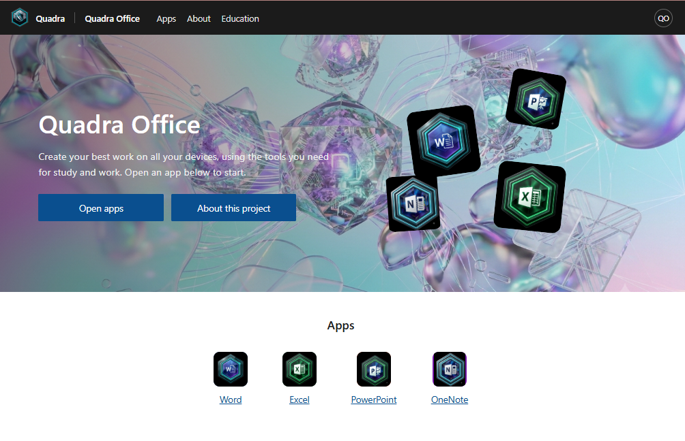
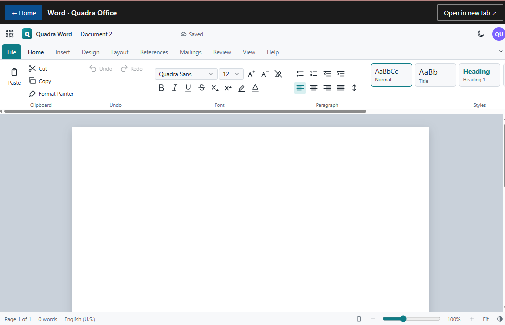
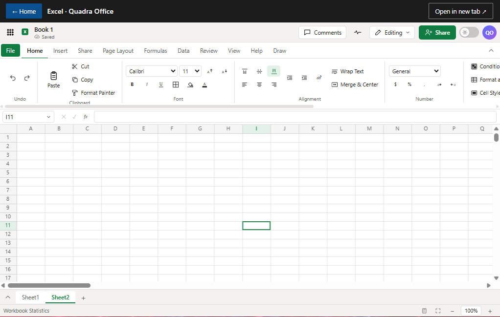
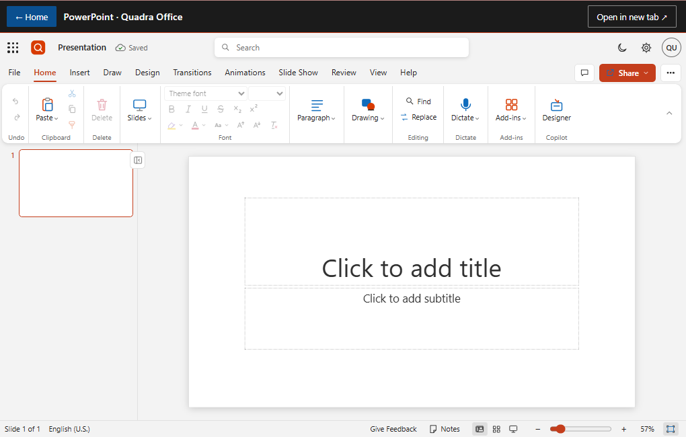
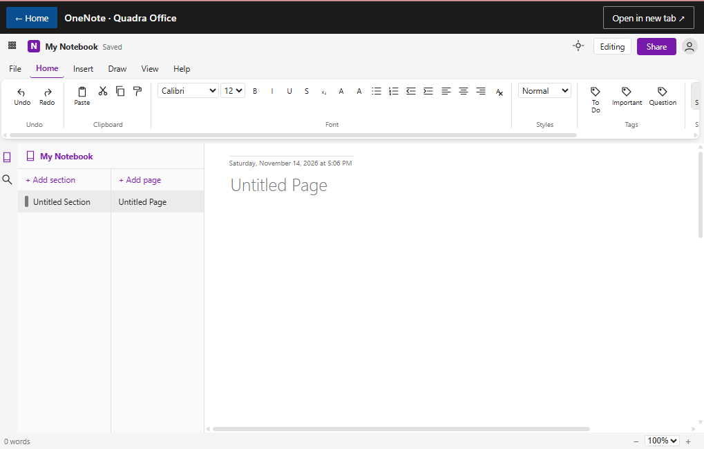

<div align="center">
  <!-- Replace the src path below with your actual SVG logo file path -->
  
  <h1>Quadra Office</h1>
  <p>
    <strong>An itch.io & Microsoft Store-Style Digital Game Storefront of the Quadra Ecosystem</strong>
  </p>
  <p>
    <a href="https://github.com/amirsohail100"></a>
    
    
    
  </p>
</div>

---

## About

**Quadra Office** is an educational project from the **Quadra** brand. It shows how a multi-app office suite can be organised as a single web application: one home page, several independent apps, a shared navigation layer, and a small backend that serves UI definitions through a REST API.

> This project is for learning only. It is not affiliated with, endorsed by, or a replacement for Microsoft Office. Its home page layout takes general inspiration from the public Microsoft 365 website for study purposes.

## Features

- **Single home page** with a dark navigation bar, hero section and app launcher
- **Four apps** (Word, Excel, PowerPoint, OneNote) that open inside the same window
- **Seamless switching** between apps. Each iframe stays alive, so unsaved work is not lost
- **Hash routing**: `#word`, `#excel`, `#powerpoint`, `#onenote` open an app directly
- **Custom branding**: logo, hero background and app icons are loaded from `static/assets/`, with automatic fallbacks
- **FastAPI backend** with Pydantic schema validation and strict payload checking
- **Desktop build** with Electron, packaged as a portable Windows `.exe`
- **Tests** for the Word, PowerPoint and OneNote engines

## Screenshots

**Home page**



| Word                                    | Excel                                     |
| --------------------------------------- | ----------------------------------------- |
|  |  |

| PowerPoint                                          | OneNote                                       |
| --------------------------------------------------- | --------------------------------------------- |
|  |  |

## Tech Stack

| Layer      | Technology                                 |
| ---------- | ------------------------------------------ |
| Frontend   | HTML5, CSS3, vanilla JavaScript            |
| Backend    | Python, FastAPI, Uvicorn                   |
| Validation | Pydantic v2                                |
| Desktop    | Electron, electron-builder                 |
| Testing    | Node.js test scripts, Python browser tests |

## Getting Started

### Prerequisites

- Python 3.10 or newer
- Node.js 18 or newer (only for the desktop build)
- Git

### 1. Clone the repository

```bash
git clone https://github.com/<your-username>/quadra-office.git
cd quadra-office
```

### 2. Run the web version

Install the Python dependencies and start the server from the project root:

```bash
pip install -r requirements.txt
uvicorn main:app --reload --port 8000
```

Then open:

| URL                               | Opens             |
| --------------------------------- | ----------------- |
| http://127.0.0.1:8000/            | Home page         |
| http://127.0.0.1:8000/word/       | Word              |
| http://127.0.0.1:8000/excel/      | Excel             |
| http://127.0.0.1:8000/powerpoint/ | PowerPoint        |
| http://127.0.0.1:8000/onenote/    | OneNote           |
| http://127.0.0.1:8000/docs        | API documentation |

### 3. Run the desktop version

```bash
npm install        # run once
npm start          # opens the desktop window
npm run build      # creates a portable .exe in dist/
```

## API Endpoints

| Method | Route              | Description                                           |
| ------ | ------------------ | ----------------------------------------------------- |
| GET    | `/api/health`      | Server health check                                   |
| GET    | `/api/excel`       | Excel UI definition (`?theme=light` or `?theme=dark`) |
| POST   | `/api/excel/cells` | Validate and acknowledge cell updates                 |
| GET    | `/api/word`        | Word UI definition                                    |
| GET    | `/api/powerpoint`  | PowerPoint UI definition                              |
| GET    | `/api/onenote`     | OneNote UI definition                                 |

Example request:

```bash
curl -X POST http://127.0.0.1:8000/api/excel/cells \
  -H "Content-Type: application/json" \
  -d '{"sheet": "Sheet1", "updates": [{"cell": "A1", "value": 42}]}'
```

## Project Structure
